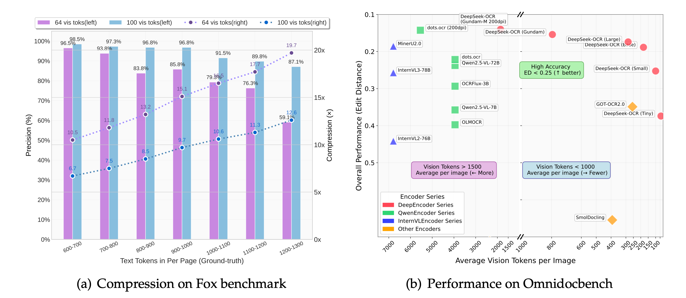

<!-- markdownlint-disable first-line-h1 -->
<!-- markdownlint-disable html -->
<!-- markdownlint-disable no-duplicate-header -->


<div align="center">
  
</div>


<hr>
<div align="center">
  <a href="https://www.deepseek.com/" target="_blank">
    
  </a>
  <a href="https://huggingface.co/deepseek-ai/DeepSeek-OCR" target="_blank">
    
  </a>

</div>

<div align="center">

  <a href="https://discord.gg/Tc7c45Zzu5" target="_blank">
    
  </a>
  <a href="https://twitter.com/deepseek_ai" target="_blank">
    
  </a>

</div>


<p align="center">
  <a href="https://huggingface.co/deepseek-ai/DeepSeek-OCR"><b>📥 Model Download</b></a> |
  <a href="https://github.com/deepseek-ai/DeepSeek-OCR/blob/main/DeepSeek_OCR_paper.pdf"><b>📄 Paper Link</b></a> |
  <a href="https://arxiv.org/abs/2510.18234"><b>📄 Arxiv Paper Link</b></a> |
</p>

<h2>
<p align="center">
  <a href="">DeepSeek-OCR: Contexts Optical Compression</a>
</p>
</h2>

<p align="center">

</p>
<p align="center">
<a href="">Explore the boundaries of visual-text compression.</a>       
</p>

## Release
- [2026/01/27]🚀🚀🚀🚀🚀🚀 We present [DeepSeek-OCR2](https://github.com/deepseek-ai/DeepSeek-OCR-2)
- [2025/10/23]🚀🚀🚀 DeepSeek-OCR is now officially supported in upstream [vLLM](https://docs.vllm.ai/projects/recipes/en/latest/DeepSeek/DeepSeek-OCR.html#installing-vllm). Thanks to the [vLLM](https://github.com/vllm-project/vllm) team for their help.
- [2025/10/20]🚀🚀🚀 We release DeepSeek-OCR, a model to investigate the role of vision encoders from an LLM-centric viewpoint.

## Contents
- [Install](#install)
- [vLLM Inference](#vllm-inference)
- [Transformers Inference](#transformers-inference)
  


## Install
>Our environment is cuda11.8+torch2.6.0.
1. Clone this repository and navigate to the DeepSeek-OCR folder
```bash
git clone https://github.com/deepseek-ai/DeepSeek-OCR.git
```
2. Conda
```Shell
conda create -n deepseek-ocr python=3.12.9 -y
conda activate deepseek-ocr
```
3. Packages

- download the vllm-0.8.5 [whl](https://github.com/vllm-project/vllm/releases/tag/v0.8.5) 
```Shell
pip install torch==2.6.0 torchvision==0.21.0 torchaudio==2.6.0 --index-url https://download.pytorch.org/whl/cu118
pip install vllm-0.8.5+cu118-cp38-abi3-manylinux1_x86_64.whl
pip install -r requirements.txt
pip install flash-attn==2.7.3 --no-build-isolation
```
**Note:** if you want vLLM and transformers codes to run in the same environment, you don't need to worry about this installation error like: vllm 0.8.5+cu118 requires transformers>=4.51.1
**Note:** install in the exact order above — torch first, then the vLLM whl — otherwise the xformers sdist pulled in by vLLM fails its build with `ModuleNotFoundError: No module named 'torch'` (see issue #296).
**Note (transformers version pin):** the `transformers` inference path requires `transformers==4.46.3` + `tokenizers==0.20.3` exactly as pinned in `requirements.txt` — the custom `modeling_deepseekocr.py` imports `LlamaFlashAttention2`, which was removed in newer transformers releases (`ImportError`, see issue #302). Newer/upstream vLLM pulls `transformers>=4.51.1`, which conflicts with that pin (see issue #307) — if you need both paths, use two separate conda envs.
**Note (platform):** the pinned `vllm-0.8.5+cu118-...-manylinux1_x86_64.whl` is Linux x86_64 + CUDA only. It cannot install on macOS (`is not a supported wheel on this platform`, see issue #319) and there is no CPU/MPS support — a CUDA GPU is required (`flash-attn`, `.cuda()`, `cu118` wheels throughout). Windows users: use WSL2 with CUDA (see community guide in issue #341); macOS / Ascend NPU (see issue #316) / serverless CPU (see issue #315) are not supported by this install flow.

## vLLM-Inference
- VLLM:
>**Note:** change the INPUT_PATH/OUTPUT_PATH and other settings in the DeepSeek-OCR-master/DeepSeek-OCR-vllm/config.py
```Shell
cd DeepSeek-OCR-master/DeepSeek-OCR-vllm
```
1. image: streaming output
```Shell
python run_dpsk_ocr_image.py
```
2. pdf: concurrency ~2500tokens/s(an A100-40G)
```Shell
python run_dpsk_ocr_pdf.py
```
3. batch eval for benchmarks
```Shell
python run_dpsk_ocr_eval_batch.py
```

**[2025/10/23] The version of upstream [vLLM](https://docs.vllm.ai/projects/recipes/en/latest/DeepSeek/DeepSeek-OCR.html#installing-vllm):**

```shell
uv venv
source .venv/bin/activate
# Until v0.11.1 release, you need to install vLLM from nightly build
uv pip install -U vllm --pre --extra-index-url https://wheels.vllm.ai/nightly
```

```python
from vllm import LLM, SamplingParams
from vllm.model_executor.models.deepseek_ocr import NGramPerReqLogitsProcessor
from PIL import Image

# Create model instance
llm = LLM(
    model="deepseek-ai/DeepSeek-OCR",
    enable_prefix_caching=False,
    mm_processor_cache_gb=0,
    logits_processors=[NGramPerReqLogitsProcessor]
)

# Prepare batched input with your image file
image_1 = Image.open("path/to/your/image_1.png").convert("RGB")
image_2 = Image.open("path/to/your/image_2.png").convert("RGB")
prompt = "<image>\nFree OCR."

model_input = [
    {
        "prompt": prompt,
        "multi_modal_data": {"image": image_1}
    },
    {
        "prompt": prompt,
        "multi_modal_data": {"image": image_2}
    }
]

sampling_param = SamplingParams(
            temperature=0.0,
            max_tokens=8192,
            # ngram logit processor args
            extra_args=dict(
                ngram_size=30,
                window_size=90,
                whitelist_token_ids={128821, 128822},  # whitelist: <td>, </td>
            ),
            skip_special_tokens=False,
        )
# Generate output
model_outputs = llm.generate(model_input, sampling_param)

# Print output
for output in model_outputs:
    print(output.outputs[0].text)
```
## Transformers-Inference
- Transformers
```python
from transformers import AutoModel, AutoTokenizer
import torch
import os
os.environ["CUDA_VISIBLE_DEVICES"] = '0'
model_name = 'deepseek-ai/DeepSeek-OCR'

tokenizer = AutoTokenizer.from_pretrained(model_name, trust_remote_code=True)
model = AutoModel.from_pretrained(model_name, _attn_implementation='flash_attention_2', trust_remote_code=True, use_safetensors=True)
model = model.eval().cuda().to(torch.bfloat16)

# prompt = "<image>\nFree OCR. "
prompt = "<image>\n<|grounding|>Convert the document to markdown. "
image_file = 'your_image.jpg'
output_path = 'your/output/dir'

res = model.infer(tokenizer, prompt=prompt, image_file=image_file, output_path = output_path, base_size = 1024, image_size = 640, crop_mode=True, save_results = True, test_compress = True)
```
or you can
```Shell
cd DeepSeek-OCR-master/DeepSeek-OCR-hf
python run_dpsk_ocr.py
```
## Support-Modes
The current open-source model supports the following modes:
- Native resolution:
  - Tiny: 512×512 （64 vision tokens）✅
  - Small: 640×640 （100 vision tokens）✅
  - Base: 1024×1024 （256 vision tokens）✅
  - Large: 1280×1280 （400 vision tokens）✅
- Dynamic resolution
  - Gundam: n×640×640 + 1×1024×1024 ✅

Each mode is just a `(base_size, image_size, crop_mode)` triple for `model.infer(...)` (transformers path) — see the mapping in `DeepSeek-OCR-master/DeepSeek-OCR-hf/run_dpsk_ocr.py`:
| Mode | `base_size` | `image_size` | `crop_mode` |
|------|-------------|--------------|-------------|
| Tiny | 512 | 512 | False |
| Small | 640 | 640 | False |
| Base | 1024 | 1024 | False |
| Large | 1280 | 1280 | False |
| Gundam (default) | 1024 | 640 | True |

On the pinned vLLM path (`DeepSeek-OCR-master/DeepSeek-OCR-vllm/`), set the same triple via `BASE_SIZE` / `IMAGE_SIZE` / `CROP_MODE` in `config.py` (see issues #300, #293). Upstream vLLM (`vllm.model_executor.models.deepseek_ocr`) does not expose these knobs per-request — custom modes there need a monkeypatch (see issue #293).

## Prompts examples
```python
# document: <image>\n<|grounding|>Convert the document to markdown.
# other image: <image>\n<|grounding|>OCR this image.
# without layouts: <image>\nFree OCR.
# figures in document: <image>\nParse the figure.
# general: <image>\nDescribe this image in detail.
# rec: <image>\nLocate <|ref|>xxxx<|/ref|> in the image.
# '先天下之忧而忧'
```


## Visualizations
<table>
<tr>
<td></td>
<td></td>
</tr>
<tr>
<td></td>
<td></td>
</tr>
</table>


## Limitations
- Requires a CUDA GPU (Linux x86_64; see platform note under [Install](#install)). CPU / macOS / MPS are not supported.
- Like all generative vision-language models, output may contain hallucinations or generation loops on some inputs (e.g. dense tables, code screenshots, certain GPUs — see issues #312, #320, #339); verify critical results.
- Training-data and benchmark details live in the [paper](https://arxiv.org/abs/2510.18234); evaluation protocol questions are tracked in issues #301, #345.

## License
MIT — see [LICENSE](LICENSE).

## Acknowledgement
We would like to thank [Vary](https://github.com/Ucas-HaoranWei/Vary/), [GOT-OCR2.0](https://github.com/Ucas-HaoranWei/GOT-OCR2.0/), [MinerU](https://github.com/opendatalab/MinerU), [PaddleOCR](https://github.com/PaddlePaddle/PaddleOCR), [OneChart](https://github.com/LingyvKong/OneChart), [Slow Perception](https://github.com/Ucas-HaoranWei/Slow-Perception) for their valuable models and ideas.

We also appreciate the benchmarks: [Fox](https://github.com/ucaslcl/Fox), [OminiDocBench](https://github.com/opendatalab/OmniDocBench).

## Citation

```bibtex
@article{wei2025deepseek,
  title={DeepSeek-OCR: Contexts Optical Compression},
  author={Wei, Haoran and Sun, Yaofeng and Li, Yukun},
  journal={arXiv preprint arXiv:2510.18234},
  year={2025}
}
